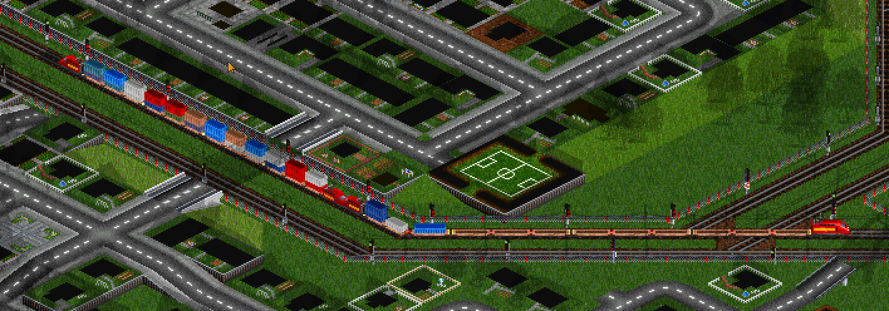
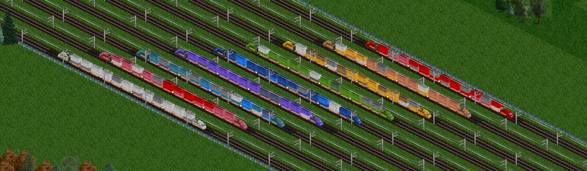

# Vanillaish Well Wagon

Simple NewGRF to intermodal containers transport

**Main Feature**: Double Stack Well Wagon

Well Wagon can transport all types of cargo except passengers and mail.

Default capacity is 60, but \
for Steel is 40 \
for Oil is 80

 \
*example train with well wagons*

 \
*containers with company colours*

#### Parameters

- **More realistic containers colours**: **This option requires: OpenTTD >= v14.0 / JGRPP > v0.66.0** Randomizer will favor blue, red and white containers
- **Running / Purchase cost factor**: Free - 1/16 - 1 - x16 
- **Raisins**: Random additional colours close to cc

#### Requires

**Recommended OpenTTD >= 14.0 or JGRPP >= 0.66.1**

#### CHANGELOG

#### 1.2
- add: containers can have company colours
- add: raisins parameters
- change: id swap:
  - default well wagon is with company colours now
  - secondary well wagon has random colours
- change: some pixels in gfx

#### 1.1
- add: params:
  - Realistic Containers Colours
  - Running Cost Factor
  - Purchase Cost Factor
- change: speed increased to 140 km/h
- change: cost factor increased 3.5 times
- change: changelog.txt to readme.txt
- fix: some strings
- fix: autorefit was not allow

#### 1.0

- add: 3 Section Well Wagon